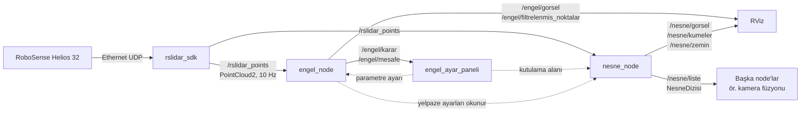

<div align="center">

# 🚧 Engel Algılama — LiDAR ile Engel ve Nesne Algılama (ROS 2)

**RoboSense Helios 32** nokta bulutundan gerçek zamanlı **DUR / DİKKAT / GÜVENLİ** kararı,
3B nesne kutuları, mesafe, kaba etiket (yaya adayı / yapı / engel) ve nesne takibi.
Türkçe, açıklamalı bir **ayar paneli** ve hazır **RViz** ekranıyla birlikte.


<br>


<sub>Gerçek LiDAR kaydı, RViz. <b>Turuncu</b>: engel kutuları · <b>mavi</b>: yaya adayı ·
<b>sarı yelpaze</b>: uyarı alanı (kırmızı yay = DUR sınırı) · <b>açık mavi</b>: kutulama alanı.
Her kutunun üstünde takip numarası, etiket ve mesafe yazar.</sub>

</div>

---

## İçindekiler

- [Ne yapar?](#-ne-yapar)
- [Ekran görüntüleri](#-ekran-görüntüleri)
- [Nasıl çalışır?](#-nasıl-çalışır)
- [Gereksinimler](#-gereksinimler)
- [Kurulum](#-kurulum)
- [LiDAR bağlantısı](#-lidar-bağlantısı)
- [LiDAR Kontrol Merkezi (önerilen)](#️-lidar-kontrol-merkezi)
- [Çalıştırma](#-çalıştırma)
- [Kayıt alma ve oynatma (rosbag)](#-kayıt-alma-ve-oynatma-rosbag)
- [Ayar paneli](#-ayar-paneli)
- [Parametreler](#-parametreler)
- [Topic'ler ve mesajlar](#-topicler-ve-mesajlar)
- [Masadan araca geçerken](#-masadan-araca-geçerken)
- [Sorun giderme](#-sorun-giderme)
- [Proje yapısı](#-proje-yapısı)
- [Lisans](#-lisans)

---

## ✨ Ne yapar?

Bu depo iki ROS 2 paketinden oluşur:

| Paket | İçerik |
|---|---|
| **`engel_algilama`** | `engel_node` (C++), `nesne_node` (C++ + PCL), `lidar_kontrol` ve `engel_ayar_paneli` (Python + Qt), launch dosyaları, RViz ekranı, kayıt/oynatma betikleri |
| **`engel_algilama_msgs`** | `Nesne` ve `NesneDizisi` mesaj tanımları |

**`engel_node` — sektör tabanlı engel kararı**
- LiDAR'ın etrafında istediğiniz yöne, istediğiniz genişlikte bir **yelpaze** (sektör) çizer.
- Yelpazenin içindeki, yükseklik ve mesafe filtresinden geçen noktalara bakar.
- En yakın engele göre **DUR** (kırmızı), **DİKKAT** (sarı) veya **GÜVENLİ** (yeşil) kararı yayınlar.
- Tek tük gürültü noktaları (toz, yağmur, yansıma) karar vermesin diye **en az N nokta** şartı ve
  mesafeyi en yakın N'inci noktaya göre ölçer.
- Engel tam sınırdayken kararın titrememesi için **histerezis** (10 cm) uygular.

**`nesne_node` — nesne algılama katmanı**
- Zemini her turda **RANSAC** ile ölçüp ayırır (sabit bir zemin yüksekliğine güvenmez).
- Kalan noktaları **kümeleyip** nesnelere ayırır (uzaktaki nesneler için mesafeye göre büyüyen tolerans).
- Her nesneyi **yönlü 3B kutu** içine alır, LiDAR'a en yakın noktasının **yatay mesafesini** ölçer.
- Kutunun şekline göre kaba etiket verir: **yaya adayı**, **yapı** (duvar vb.), **engel**.
- Nesneleri kareden kareye **takip eder**: numara, hız, yaklaşma hızı ve çarpışma süresi.
- Sonuçları `/nesne/liste` topic'inde yayınlar — başka node'lar (ör. kamera füzyonu) doğrudan okuyabilir.

**`lidar_kontrol` — LiDAR Kontrol Merkezi**
- Araçta terminal açmadan her şey tek pencereden: ana ekrandan **Engel Algılama**, **LiDAR'ı İzle**,
  **Kayıt Al** veya **Kayıt Oynat** seçilir, gereken programlar arkada kendiliğinden açılır.
- Programların durumu ve terminal çıktıları pencerenin altında; çöken program tek tıkla yeniden başlatılır.
- Kayıt oynatırken duraklatma, tur tur ilerletme, ileri/geri atlama ve hız ayarı.

**`engel_ayar_paneli` — Türkçe ayar paneli**
- Canlı karar ve yukarıdan bakış çizimi: yelpaze şu an tam olarak nereye bakıyor, kararı hangi nokta verdi.
- Her ayar için kaydırma çubuğu + ne işe yaradığının açıklaması. Değişiklikler **anında** uygulanır.
- Ayarlar otomatik kaydedilir, bir sonraki açılışta aynen yüklenir. İsimli profiller (masa, araç…),
  dışa/içe aktarma ve varsayılana dönme.

> **Not:** Hiçbir node LiDAR'ın kendisine veya sürücüsüne ayar göndermez. Sadece sürücünün
> yayınladığı `/rslidar_points` bulutunu okur ve kendi içinde filtreler.

---

## 📸 Ekran görüntüleri

Aynı ayarlarla, engel yaklaştıkça kararın değişimi (DUR sınırı 1.9 m, DİKKAT sınırı 3.0 m):

<table>
  <tr>
    <th width="33%">🟢 GÜVENLİ</th>
    <th width="33%">🟡 DİKKAT</th>
    <th width="33%">🔴 DUR</th>
  </tr>
  <tr>
    <td></td>
    <td></td>
    <td></td>
  </tr>
  <tr>
    <td align="center"><sub>Görüş alanında engel yok</sub></td>
    <td align="center"><sub>Engel önde, 2.70 m'de</sub></td>
    <td align="center"><sub>Engel solda 24°, 1.00 m'de</sub></td>
  </tr>
</table>

Yukarıdan bakış çiziminde **kırmızı** bölge DUR, **sarı** bölge DİKKAT alanıdır, **mavi kesik çizgi**
nesne kutulama alanını gösterir. Kararı veren nokta çizimde işaretlenir; üstte hangi açıda, kaç metrede
ve hangi yükseklikte olduğu yazar.

---

## 🧠 Nasıl çalışır?



### `engel_node` her turda (10 Hz)

1. **Yelpaze testi** — noktanın yatay yönü, bakış yönünden `gorus_genisligi / 2`'den fazla sapıyorsa atılır.
2. **Mesafe filtresi** — `min_mesafe`'den yakın (aracın kendisi, masa) ve `dikkat_mesafesi`'nden uzak noktalar atılır.
3. **Yükseklik filtresi** — `z_min` altındaki (zemin) ve `z_max` üstündeki (tavan, ağaç dalı) noktalar atılır.
4. **Gürültü filtresi** — kalan nokta sayısı `min_nokta_sayisi`'ndan azsa engel yok sayılır. Engel mesafesi
   olarak en yakın noktanın değil, **en yakın N'inci noktanın** mesafesi kullanılır (tek bir yansıma DUR verdiremez).
5. **Karar** — mesafe `dur_mesafesi`'nden küçükse DUR, `dikkat_mesafesi`'nden küçükse DİKKAT, değilse GÜVENLİ.
   Bir karardan **çıkmak** için engelin sınırdan 10 cm daha uzaklaşması gerekir (histerezis).

### `nesne_node` her turda

```
nokta bulutu → kutulama alanı + gövde kutusu + voxel seyreltme
             → zemin ayırma (RANSAC, zemin_z ± zemin_bant içinde)
             → kümeleme (yatay + mesafeye göre büyüyen dikey tolerans)
             → yönlü kutu + en yakın nokta mesafesi + tepe yüksekliği
             → kaba etiket (yaya_adayi / yapi / engel)
             → takip (numara, hız, yaklaşma hızı, çarpışma süresi)
             → /nesne/liste + RViz görselleri
```

Algoritmalar ROS'tan bağımsız olarak `src/engel_algilama/src/nesne/` altındadır
(`zemin`, `kumeleme`, `kutu`, `takip`); ROS tarafı sadece `nesne_node.cpp`'dedir.

> ⚠️ Etiketler **kural tabanlıdır ve kabadır**. "Yaya adayı" kesin bir yaya kararı değildir;
> kutunun boyutuna ve tepe yüksekliğine bakılarak verilen bir tahmindir.

---

## 📋 Gereksinimler

| | Sürüm |
|---|---|
| İşletim sistemi | Ubuntu 24.04 |
| ROS 2 | Jazzy (desktop kurulumu — RViz dahil) |
| Derleyici | C++17 destekli GCC |
| LiDAR | RoboSense Helios 32 (başka RoboSense modelleri de `rslidar_sdk` ayarıyla çalışır) |
| LiDAR sürücüsü | [`rslidar_sdk`](https://github.com/RoboSense-LiDAR/rslidar_sdk) + [`rslidar_msg`](https://github.com/RoboSense-LiDAR/rslidar_msg) |

Ek sistem paketleri:

```bash
sudo apt install ros-jazzy-pcl-conversions libpcl-dev ros-jazzy-python-qt-binding python3-yaml zenity
```

> `zenity` sadece kayıt/oynatma betiklerinin isim sorma ve klasör seçme pencereleri için gerekir.
> LiDAR kaydı oynatmak için ayrıca `ros-jazzy-rosbag2-storage-mcap` gerekir (genelde desktop kurulumuyla gelir).

---

## 🔧 Kurulum

### 1) Çalışma alanını oluşturun ve depoyu klonlayın

> Betikler çalışma alanının **`~/lidar_ws`** olduğunu varsayar. Başka bir yere kuracaksanız
> [`ros_ortami.sh`](src/engel_algilama/scripts/ros_ortami.sh) içindeki yolları değiştirin.

```bash
cd ~
git clone https://github.com/ayberkdoruk/lidar_ws.git lidar_ws
cd ~/lidar_ws/src
```

### 2) LiDAR sürücüsünü ekleyin

Sürücü bu depoya dahil değildir, RoboSense'in kendi deposundan alınır:

```bash
cd ~/lidar_ws/src
git clone https://github.com/RoboSense-LiDAR/rslidar_sdk.git
cd rslidar_sdk && git submodule init && git submodule update && cd ..
git clone https://github.com/RoboSense-LiDAR/rslidar_msg.git
```

Sürücüde iki ayar yapın:

**`rslidar_sdk/CMakeLists.txt`** — nokta tipini `XYZIRT` yapın:

```cmake
set(POINT_TYPE XYZIRT)
```

**`rslidar_sdk/config/config.yaml`** — LiDAR modelini seçin:

```yaml
common:
  msg_source: 1                  # 1 = canlı LiDAR
  send_point_cloud_ros: true
lidar:
  - driver:
      lidar_type: RSHELIOS       # Helios 32
      msop_port: 6699
      difop_port: 7788
    ros:
      ros_frame_id: rslidar
      ros_send_point_cloud_topic: /rslidar_points
```

### 3) Derleyin

```bash
cd ~/lidar_ws
source /opt/ros/jazzy/setup.bash
rosdep install --from-paths src --ignore-src -r -y
colcon build --symlink-install
source install/setup.bash
```

### 4) Ortam değişkenlerini ayarlayın (önerilir)

Nokta bulutu mesajları ~1.5 MB'tır. Fast DDS'in varsayılan paylaşımlı bellek segmenti (512 KB) bunun
için küçük kalır ve mesajlar kaybolur. Depodaki [`fastdds_buyuk_mesaj.xml`](fastdds_buyuk_mesaj.xml)
segmenti 16 MB yapar. `~/.bashrc` dosyanızın sonuna ekleyin:

```bash
source /opt/ros/jazzy/setup.bash
source ~/lidar_ws/install/setup.bash
export ROS_DOMAIN_ID=42                         # ağdaki diğer ROS bilgisayarlarından ayrı
export ROS_AUTOMATIC_DISCOVERY_RANGE=LOCALHOST  # sadece bu bilgisayar
export FASTRTPS_DEFAULT_PROFILES_FILE=~/lidar_ws/fastdds_buyuk_mesaj.xml
```

---

## 🔌 LiDAR bağlantısı

1. LiDAR'ı güç kutusuna ve Ethernet kablosuyla bilgisayara bağlayın.
2. Bilgisayarın kablolu ağ arayüzüne LiDAR'ın veri gönderdiği adresi **sabit IP** olarak verin.
   RoboSense cihazlarında fabrika ayarı genelde LiDAR `192.168.1.200`, bilgisayar `192.168.1.102`'dir;
   cihazınızın etiketine / kılavuzuna bakın.
3. Sürücüyü tek başına açıp veri geldiğini kontrol edin:

```bash
ros2 launch rslidar_sdk start.py
```

```bash
ros2 topic hz /rslidar_points
```

Saniyede ~10 mesaj görüyorsanız bağlantı tamamdır.

---

## 🖥️ LiDAR Kontrol Merkezi

Araca oturan kişinin terminal açıp komut yazmadan her şeyi tek pencereden yönetmesi için.

```bash
ros2 run engel_algilama lidar_kontrol
```

Masaüstü simgesi için programda **Ayarlar → Masaüstü kısayolunu oluştur**'a basın; masaüstüne ve
uygulama menüsüne **LiDAR Kontrol** simgesi gelir (terminal penceresi açmadan çalışır).

**Ana ekran** LiDAR'dan kablo üzerinden paket gelip gelmediğini (sürücüyü açmadan), diskte kaç saatlik
kayda yer kaldığını, son kullanılan ayar profilini ve kayıtları gösterir. Dört bölümden birine tıklayın:

| Bölüm | Arkada açılanlar | Neler yapılır |
|---|---|---|
| 🚧 **Engel Algılama** | LiDAR sürücüsü, `engel_node`, `nesne_node`, RViz | Canlı karar, yukarıdan bakış çizimi (nesne kutuları, gövde kutusu), canlı nesne tablosu, çalışırken değişen **tüm** ayarlar, profiller, sayfadan çıkmadan kayıt |
| 📡 **LiDAR'ı İzle** | LiDAR sürücüsü, RViz (sadece ham bulut) | Saniyedeki tur, tur başına nokta, kopan turlar, sürücü ayarları (sadece gösterilir), kayıt |
| ⏺ **Kayıt Al** | LiDAR sürücüsü (+ istenirse RViz) | İsim, süre, sıkıştırma; geçen süre / boyut / tur; kayıt listesi: oynat, adını değiştir, çöp kutusuna at |
| ▶ **Kayıt Oynat** | Kayıt oynatıcı, `engel_node`, `nesne_node`, RViz | Duraklat / devam, tek tur ilerlet, ilerleme çubuğuyla atla, hız 0.1×–2×, döngü; Engel Algılama'daki ayar paneli |

- **Sadece fark açılır/kapanır.** LiDAR'ı İzle'den Engel Algılama'ya geçerken sürücü açık kalır. Ayarı
  değişen program (RViz aç/kapat, nesne algılama aç/kapat, oynatıcının döngü ayarı, başka kayıt seçmek)
  kendiliğinden yeniden başlatılır; pencere hiç kapanmaz.
- **⌂ Ana ekran** o bölümün açtığı her şeyi kapatır. Pencere kapatılınca programlar düzgünce (Ctrl+C ile)
  kapatılır, kayıt dosyası yarım kalmaz. Arayüz çökse bile açtığı programlar da kapanır.
- Kayıt sürerken sürücünün açık kaldığı bölümler (İzle ↔ Engel Algılama ↔ Kayıt Al) arasında geçilebilir.
- Her programın terminal çıktısı alttaki **Program çıktıları** bölümündedir. Bir program çökerse sayfanın
  üstünde kırmızı bant ve **Yeniden başlat** düğmesi çıkar.
- Eski kısayollardan ya da bir terminalden açılmış sürücü / node / oynatıcı varsa uyarır ve kapatmayı önerir
  (iki sürücü aynı LiDAR portunu kullanamaz, kayıt ile canlı veri karışır).
- LiDAR sürücüsünün ayarları (`rslidar_sdk/config/config.yaml`) **değiştirilmez**, sadece gösterilir.
- **⚙ Ayarlar:** kayıt klasörü, bölüme girince RViz açılsın mı, RViz bu pencerenin yanına yerleşsin mi
  (ekranı ikiye böler), nesne algılama varsayılanı, koyu / açık tema, varsayılan sıkıştırma, masaüstü
  kısayolu. Dosyası: `~/.ros/engel_algilama/arayuz.yaml`.

> Simgeden açılınca programın kendi çıktısı `~/.ros/engel_algilama/lidar_kontrol.log` dosyasına yazılır;
> açılırken hata verirse son satırlar bir pencerede gösterilir.

---

## 🚀 Çalıştırma

### Her şey tek komutla (LiDAR sürücüsü + RViz + node'lar + panel)

```bash
ros2 launch engel_algilama sistem.launch.py
```

### Sadece algılama (sürücü başka yerde açıksa)

```bash
ros2 launch engel_algilama engel.launch.py
```

### Launch seçenekleri

| Argüman | Varsayılan | Açıklama |
|---|---|---|
| `surucu` | `true` | `sistem.launch.py`: LiDAR sürücüsünü aç. Rosbag oynatırken `false` |
| `panel` | `true` | Ayar panelini aç |
| `nesne` | `true` | `nesne_node`'u (kutu / mesafe / takip) aç |

Örnekler:

```bash
ros2 launch engel_algilama sistem.launch.py surucu:=false
```

```bash
ros2 launch engel_algilama engel.launch.py panel:=false nesne:=false
```

### Node'ları tek tek çalıştırmak

```bash
ros2 run engel_algilama engel_node --ros-args --params-file src/engel_algilama/config/engel_params.yaml
```

```bash
ros2 run engel_algilama nesne_node --ros-args --params-file src/engel_algilama/config/nesne_params.yaml
```

```bash
ros2 run engel_algilama engel_ayar_paneli
```

### Masaüstü kısayolları (isteğe bağlı)

> Önerilen yol tek simgeli [LiDAR Kontrol Merkezi](#️-lidar-kontrol-merkezi)'dir. Aşağıdaki betikler
> terminalden kullanmak isteyenler için duruyor.

`scripts/` altındaki betikler masaüstü simgesinden çift tıkla açılmak için hazırlandı
(`~/.bashrc`'yi okumadıkları için ROS ortamını [`ros_ortami.sh`](src/engel_algilama/scripts/ros_ortami.sh) üzerinden kurarlar):

| Betik | Ne yapar |
|---|---|
| `engel_sistemi_baslat.sh` | Tüm sistemi açar. Sürücü zaten açıksa ikinci kez açmaz |
| `lidar_kayit.sh` | LiDAR verisini `~/lidar_kayitlar/` altına kaydeder |
| `lidar_oynat.sh` | Bir kaydı RViz + node'larla birlikte, sonsuz döngüde oynatır |

Örnek kısayol (`~/Desktop/engel-algilama.desktop`):

```ini
[Desktop Entry]
Type=Application
Name=Engel Algılama
Comment=LiDAR sürücüsü + RViz + engel algılama ayar paneli
Exec=/home/KULLANICI/lidar_ws/src/engel_algilama/scripts/engel_sistemi_baslat.sh
Icon=/home/KULLANICI/lidar_ws/src/engel_algilama/resource/engel_algilama.svg
Terminal=true
Categories=Science;
```

Dosyayı oluşturduktan sonra sağ tık → **Başlatmaya izin ver**.

---

## 🎞️ Kayıt alma ve oynatma (rosbag)

LiDAR'ı her seferinde kurmadan geliştirme yapmak için gerçek veriyi kaydedip tekrar oynatabilirsiniz.

**Kayıt** (önce sistem açık ve RViz'de noktalar görünür olmalı):

```bash
~/lidar_ws/src/engel_algilama/scripts/lidar_kayit.sh oda_yurume 60
```

- İsim verilmezse sorar, süre verilmezse `Ctrl+C`'ye kadar kaydeder.
- Kayıt `~/lidar_kayitlar/TARIH_SAAT_isim/` klasörüne, MCAP biçiminde, `zstd` sıkıştırmalı gider.
- Dakikada ~0.5–0.9 GB yer kaplar. Bilgisayar kasarsa: `SIKISTIRMA=yok lidar_kayit.sh ...`

**Oynatma** (LiDAR takılı olmasına gerek yok; canlı sürücü **kapalı** olmalı):

```bash
~/lidar_ws/src/engel_algilama/scripts/lidar_oynat.sh ~/lidar_kayitlar/2026-11-20_15-30-00_oda_yurume
```

- Klasör verilmezse seçme penceresi açılır. Üçüncü argüman hızdır: `... KAYIT 0.5` → yarı hız.
- RViz, node'lar ve panel açılır; kayıt sonsuz döngüde oynar. Durdurmak için `Ctrl+C`.

---

## 🎛️ Ayar paneli

Panel `rqt_reconfigure` yerine, ne değiştirdiğinizi görerek ayar yapmanız için yazıldı.

<p align="center">
  
</p>

- **Sol taraf:** büyük renkli karar kutusu (DUR / DİKKAT / GÜVENLİ + mesafe), kararı veren noktanın
  açısı/mesafesi/yüksekliği ve yukarıdan bakış çizimi. Dış çember ölçeği altta yazar.
- **Çizim:** uyarı yelpazesi (sarı / kırmızı), kutulama alanı (mavi kesik çizgi), gövde kutusu (taralı)
  ve `nesne_node`'un bulduğu nesne kutuları. Fare tekerleğiyle yakınlaştırılır, çift tıkla eski ölçeğe döner.
- **Nesne tablosu:** takip numarası, etiket, mesafe, yön, hız, yaklaşma hızı, çarpışma süresi.
- **Sağ taraf:** iki node'un çalışırken değişebilen **tüm** ayarları 7 sekmede — *Uyarı alanı*, *Filtreler*,
  *Kutulama alanı*, *Zemin*, *Kümeleme*, *Etiket*, *Takip*. Her ayarda kaydırma çubuğu, klavyeyle yazılabilen
  değer kutusu, açıklama ve varsayılana döndürme düğmesi var. Birbiriyle çelişen değerler (ör. DUR ≥ DİKKAT)
  kırmızı gösterilir ve düzeltilene kadar gönderilmez.
- **Kayıtlı ayarlar:**
  - Uyguladığınız her değişiklik `~/.ros/engel_algilama/son_ayarlar.yaml` dosyasına **otomatik**
    kaydedilir ve launch dosyası açılışta bunu varsayılanların üstüne yükler.
  - **Kaydet…** ile isimli profil oluşturun (`~/.ros/engel_algilama/profiller/`), **Yükle** ile geri getirin.
  - **Dışa aktar / İçe aktar** ile ayarları başka bilgisayara taşıyın.
  - Kayıt dosyaları ROS parametre dosyası biçimindedir, `--params-file` ile doğrudan da kullanılabilir.
- Bir node kapalıysa onun sekmeleri kilitli kalır ve son kaydedilen değerleri gösterir; o sırada yüklenen
  profilin değerleri node açılınca uygulanır.
- Aynı panel LiDAR Kontrol Merkezi'nin Engel Algılama ve Kayıt Oynat bölümlerinde de var.

---

## ⚙️ Parametreler

Tüm parametreler **çalışırken** değiştirilebilir (panelden veya `ros2 param set` ile).
Ondalıklı değerleri YAML'da mutlaka `90.0` gibi noktalı yazın, yoksa ROS tip hatası verir.

Eksenler LiDAR'a göredir: **x = ileri, y = sol, z = yukarı**, birim metre.
Açılar derece: **0 = ön, +90 = sol, −90 = sağ, 180 = arka**.

### `engel_node` — [`config/engel_params.yaml`](src/engel_algilama/config/engel_params.yaml)

| Parametre | Varsayılan | Açıklama |
|---|---|---|
| `merkez_aci` | `0.0` | Yelpazenin baktığı yön (°) |
| `gorus_genisligi` | `90.0` | Yelpazenin toplam açısı (°). `360` = her yön |
| `min_mesafe` | `0.3` | Bundan yakın noktalar yok sayılır (aracın kendisi, masa) |
| `z_min` | `-1.2` | LiDAR merkezinden bu kadar aşağısı yok sayılır — **zeminin biraz üstünde olmalı** |
| `z_max` | `1.0` | LiDAR merkezinden bu kadar yukarısı yok sayılır (tavan, dal, köprü) |
| `dur_mesafesi` | `2.0` | Engel bundan yakınsa **DUR** |
| `dikkat_mesafesi` | `5.0` | Engel bundan yakınsa **DİKKAT**. Daha uzağı işlenmez |
| `min_nokta_sayisi` | `10` | Engel sayılması için en az nokta; mesafe en yakın N'inci noktaya göre ölçülür |
| `canli_izleme` | `true` | Her turda karar + mesafe terminale yazılır |

### `nesne_node` — [`config/nesne_params.yaml`](src/engel_algilama/config/nesne_params.yaml)

Varsayılanlar **masa** düzenine göredir (LiDAR masada, zemin ~0.81 m aşağıda).

<details>
<summary><b>Tüm parametreleri göster</b></summary>

| Grup | Parametre | Varsayılan | Açıklama |
|---|---|---|---|
| Alan | `nesne_merkez_aci` | `0.0` | Kutulama alanının yönü (°) — uyarı yelpazesinden **bağımsız** |
| | `nesne_gorus_genisligi` | `120.0` | Kutulama alanının açısı (°) |
| | `menzil` | `20.0` | Bundan uzak noktalar işlenmez (yatay, m) |
| | `govde_x_min` … `govde_y_max` | masa ölçüleri | Gövde kutusu: içindeki noktalar yok sayılır. Hepsi `0.0` = kapalı |
| | `voxel_boyu` | `0.08` | Nokta seyreltme küp boyu (m). `0.0` = kapalı |
| Zemin | `zemin_z` | `-0.81` | Beklenen zemin yüksekliği. Araçta: `-montaj_yüksekliği` |
| | `zemin_bant` | `0.30` | Zemin sadece `zemin_z ± bant` içinde aranır |
| | `zemin_esik` | `0.10` | Zemin düzlemine bundan yakın nokta zemin sayılır |
| | `zemin_max_egim` | `10.0` | Zemin en fazla bu kadar eğik olabilir (°) |
| | `zemin_min_nokta` | `30` | Zemin düzleminin kabulü için en az nokta |
| | `max_yukseklik` | `2.5` | Zeminden bu kadar yukarısı yok sayılır |
| Kümeleme | `kume_yatay_tol` | `0.35` | Aynı nesne için en fazla yatay aralık (m) |
| | `kume_dikey_taban` / `kume_dikey_artis` | `0.25` / `0.04` | Dikey eşik = taban + artış × mesafe |
| | `kume_min_nokta` / `kume_max_nokta` | `5` / `20000` | Küme boyut sınırları |
| Etiket | `yaya_min_tepe` / `yaya_max_tepe` | `1.0` / `2.1` | Yaya adayı: tepe noktası zeminden bu aralıkta |
| | `yaya_max_uzunluk` / `yaya_max_genislik` | `1.2` / `1.0` | …ve taban en fazla bu boyutta |
| | `yapi_min_uzunluk` / `yapi_max_genislik` | `2.5` / `0.5` | Yapı: uzun ve ince |
| | `yapi_kesin_uzunluk` | `6.0` | …ya da bundan uzun her şey |
| Takip | `takip_kapi` | `1.0` | Bir turda en fazla bu kadar yer değiştirebilir (m) |
| | `takip_dogrulama` | `3` | Yeni nesne bu kadar tur üst üste görülünce numara alır |
| | `takip_kayip` | `5` | Bu kadar tur görülmeyen nesne silinir |
| | `canli_izleme` | `true` | Saniyede bir özet satırı |

</details>

Çalışırken değiştirme örneği:

```bash
ros2 param set /engel_node dur_mesafesi 1.5
```

```bash
ros2 param set /nesne_node zemin_z -1.80
```

---

## 📡 Topic'ler ve mesajlar

### Giriş

| Topic | Tip | Açıklama |
|---|---|---|
| `/rslidar_points` | `sensor_msgs/PointCloud2` | LiDAR nokta bulutu (frame `rslidar`, ~10 Hz, SensorData QoS) |

### `engel_node` çıkışları

| Topic | Tip | Açıklama |
|---|---|---|
| `/engel/karar` | `std_msgs/String` | `DUR`, `DIKKAT` veya `GUVENLI` |
| `/engel/mesafe` | `std_msgs/Float32` | Engelin mesafesi (m) |
| `/engel/engel_noktasi` | `geometry_msgs/PointStamped` | Kararı veren noktanın konumu |
| `/engel/filtrelenmis_noktalar` | `sensor_msgs/PointCloud2` | Tüm filtrelerden geçen noktalar |
| `/engel/gorsel` | `visualization_msgs/MarkerArray` | Yelpaze, DUR/DİKKAT yayları, karar yazısı |

### `nesne_node` çıkışları

| Topic | Tip | Açıklama |
|---|---|---|
| `/nesne/liste` | `engel_algilama_msgs/NesneDizisi` | Takip edilen tüm nesneler |
| `/nesne/gorsel` | `visualization_msgs/MarkerArray` | Kutular, numara/etiket/mesafe yazıları, hız okları |
| `/nesne/kumeler` | `sensor_msgs/PointCloud2` | Her nesne ayrı renkte noktalar |
| `/nesne/zemin` | `sensor_msgs/PointCloud2` | Zemin olarak ayrılan noktalar |
| `/nesne/zemin_disi` | `sensor_msgs/PointCloud2` | Zemin dışında kalan noktalar |

### `engel_algilama_msgs/Nesne`

```
uint32 id                          # takip numarası
string etiket                      # "yaya_adayi" | "yapi" | "engel"
float32 guven                      # 0..1, kural tabanlı güven puanı

geometry_msgs/Point merkez         # kutunun merkezi
geometry_msgs/Vector3 boyut        # x = uzunluk, y = genişlik, z = yükseklik
float32 yon                        # kutunun z ekseni etrafındaki açısı (radyan)

geometry_msgs/Point en_yakin_nokta # LiDAR'a en yakın nokta
float32 mesafe                     # en yakın noktanın yatay mesafesi (m)
float32 tepe_yuksekligi            # en üst noktanın zemin üstü yüksekliği (m)

geometry_msgs/Vector3 hiz          # m/s
float32 yaklasma_hizi              # m/s, pozitif = LiDAR'a yaklaşıyor
float32 carpisma_suresi            # saniye; yaklaşmıyorsa -1

bool uyari_alaninda                # engel_node'un uyarı yelpazesinin içinde mi
uint32 nokta_sayisi
uint32 yas                         # kaç turdur takipte
```

Hızlıca izlemek için:

```bash
ros2 topic echo /engel/karar
```

```bash
ros2 topic echo /nesne/liste --field nesneler
```

---

## 🚗 Masadan araca geçerken

Varsayılan değerler LiDAR masadayken ölçüldü. Araca takarken en az şunları güncelleyin:

| Ayar | Masada | Araçta (örnek: LiDAR yerden 1.8 m) |
|---|---|---|
| `engel_node.z_min` | `-0.1` … `-0.6` | `-1.6` civarı (zeminin ~20 cm üstü) |
| `engel_node.min_mesafe` | `~1.0` | Aracın gövdesi kadar |
| `nesne_node.zemin_z` | `-0.81` | `-1.80` |
| `nesne_node.govde_*` | masa ölçüleri | Aracın LiDAR'a göre kutusu |

> 💡 `z_min` çok aşağıda kalırsa **zemin engel sanılır** ve sürekli DUR alırsınız. Panelde *Alt sınır (zemin)*
> çubuğunu, RViz'de zemin noktaları kaybolana kadar yukarı alın.

Panelde **Kaydet…** ile `masa` ve `arac` diye iki profil oluşturup ortam değiştikçe tek tıkla geçebilirsiniz.

---

## 🩺 Sorun giderme

| Belirti | Olası neden / çözüm |
|---|---|
| RViz'de nokta yok | Ethernet IP'si yanlış veya `lidar_type` hatalı. `ros2 topic hz /rslidar_points` ile kontrol edin |
| Node'lar veri almıyor / takılıyor | Fast DDS büyük mesaj ayarı eksik. `FASTRTPS_DEFAULT_PROFILES_FILE` değişkenini verin ([Kurulum 4](#4-ortam-değişkenlerini-ayarlayın-önerilir)) |
| Sürekli DUR | `z_min` zemine çok yakın, ya da `min_mesafe` aracın/masanın kendisini içine alıyor |
| Küçük cisimler kaçıyor | `min_nokta_sayisi`'nı azaltın |
| Toz/yağmurda yanlış DUR | `min_nokta_sayisi`'nı artırın (20–30) |
| Ondalıklı parametrede "tip uyuşmuyor" | YAML'da `90` yerine `90.0` yazın |
| Başka bilgisayarın ROS verisi karışıyor | `ROS_DOMAIN_ID` ve `ROS_AUTOMATIC_DISCOVERY_RANGE=LOCALHOST` |
| Kayıt oynatınca veri karışık | Canlı sürücü açık kalmış — ikisi aynı topic'e yayın yapar. Sürücüyü kapatın |
| LiDAR Kontrol simgeden açılmıyor | `~/.ros/engel_algilama/lidar_kontrol.log` dosyasına bakın; paket derlenmemiş olabilir |
| LiDAR Kontrol "başka yerden açılmış programlar" diyor | Eski kısayolla ya da terminalden açılmış sürücü / node açık. Uyarıdaki **Hepsini kapat**'a basın |
| PCL derlenirken `CMP0144 / FLANN_ROOT` uyarısı | PCL'in kendi CMake dosyasından gelir, zararsızdır |

---

## 🗂️ Proje yapısı

```
lidar_ws/
├── fastdds_buyuk_mesaj.xml          # 1.5 MB'lık bulut mesajları için Fast DDS ayarı
├── docs/images/                     # README görselleri
└── src/
    ├── engel_algilama/
    │   ├── config/
    │   │   ├── engel_params.yaml    # engel_node varsayılanları
    │   │   └── nesne_params.yaml    # nesne_node varsayılanları
    │   ├── launch/
    │   │   ├── sistem.launch.py     # sürücü + RViz + node'lar + panel
    │   │   └── engel.launch.py      # node'lar + panel
    │   ├── rviz/engel.rviz          # hazır RViz ekranı
    │   ├── resource/                # uygulama simgesi
    │   ├── scripts/
    │   │   ├── lidar_kontrol.py     # LiDAR Kontrol Merkezi (tek pencere)
    │   │   ├── lidar_kontrol_baslat.sh  # masaüstü simgesi bunu açar
    │   │   ├── engel_ayar_paneli.py # tek başına ayar paneli (launch dosyaları açar)
    │   │   ├── lidar_arayuz/        # iki arayüzün ortak Python paketi (sayfalar, süreç yönetimi, ayarlar)
    │   │   ├── engel_sistemi_baslat.sh
    │   │   ├── lidar_kayit.sh
    │   │   ├── lidar_oynat.sh
    │   │   └── ros_ortami.sh        # betiklerin ortak ROS ortamı
    │   └── src/
    │       ├── engel_node.cpp       # sektör tabanlı DUR / DİKKAT / GÜVENLİ
    │       ├── nesne_node.cpp       # nesne algılamanın ROS tarafı
    │       └── nesne/               # ROS'tan bağımsız algoritmalar
    │           ├── zemin.*          #   RANSAC zemin ayırma
    │           ├── kumeleme.*       #   nokta kümeleme
    │           ├── kutu.*           #   yönlü kutu + etiket
    │           └── takip.*          #   nesne takibi
    └── engel_algilama_msgs/
        └── msg/
            ├── Nesne.msg
            └── NesneDizisi.msg
```

> `rslidar_sdk` ve `rslidar_msg` bu depoda takip edilmez; [Kurulum 2](#2-lidar-sürücüsünü-ekleyin) adımında ayrıca klonlanır.

---

## 📄 Lisans

[Apache License 2.0](LICENSE)
