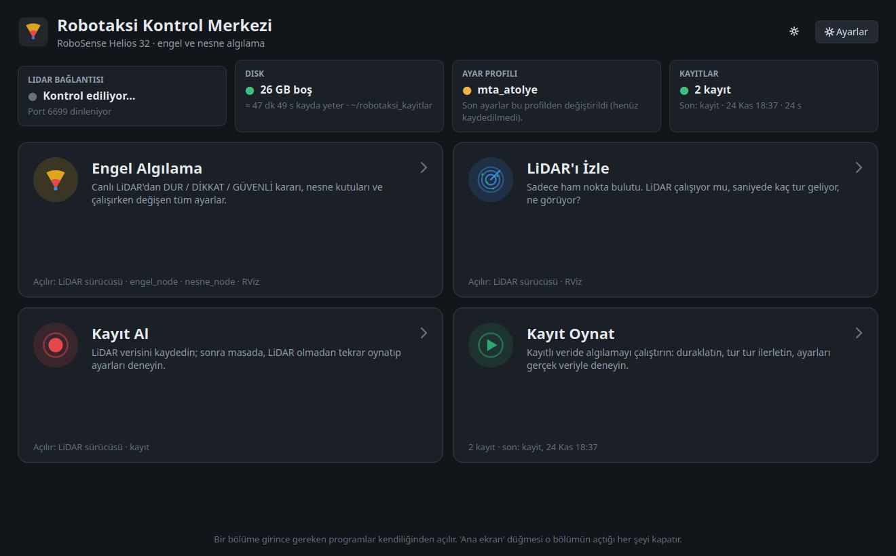
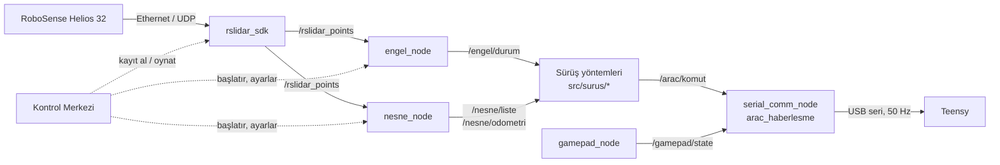

<div align="center">


# Robotaksi Autonomy

**Robotaksi otonom araç yarışması için ROS 2 yazılım yığını**

LiDAR ile gerçek zamanlı engel ve hareketli nesne algılama · terminalsiz Kontrol Merkezi ·
yarışan sürüş yöntemleri için katmanlı çalışma alanı

[](https://github.com/ayberkdoruk/robotaksi-autonomy/actions/workflows/build.yml)


[](LICENSE)

<br>


<sub>Gerçek LiDAR kaydı üzerinde algılama katmanı (RViz): uyarı yelpazesi, DİKKAT kararı, takip edilen
nesne kutuları, etiketler ve mesafeler.</sub>

</div>

---

## ✨ Öne çıkanlar

- **Gerçek zamanlı engel kararı** — RoboSense Helios 32 bulutundan, ayarlanabilir bir yelpaze içinde
  10 Hz'te **DUR / DİKKAT / GÜVENLİ** kararı, en yakın engelin mesafesi ve konumu (`engel_node`).
- **Hareketli nesne algılama** — RANSAC zemin ayırma, mesafeye uyarlanan kümeleme, yönlü 3B kutular ve
  Kalman tabanlı takip. Bir noktanın yeri az önce **boş görülmüş mü** (görünürlük testi) diye bakarak
  yayaları duvar ve park etmiş araçlardan ayırır; aracın önündeki **yol koridorundaki** her şeyi gösterir
  (`nesne_node`).
- **Odometrisiz araç hareketi** — araçta tekerlek sayacı / IMU olmadan, ardışık LiDAR taramalarını 2B ICP
  ile üst üste oturtarak aracın hareketini bulur; takip yere göre, çarpışma süresi araca göre hesaplanır.
- **Kontrol Merkezi** — araca oturan kişinin terminal açmadan sürücüyü, algılamayı, kayıt almayı ve
  kayıt oynatmayı tek pencereden yönettiği Qt arayüzü; çalışırken değişen tüm ayarlar canlı.
- **Gerçek veriyle geliştirme** — her şey sahada alınan kayıtlarla (rosbag2 / MCAP) masada tekrar
  oynatılıp ayarlanabilir: duraklat, tur tur ilerlet, hızlandır.
- **Ekip için tasarlandı** — ortak zemin (sürücüler, mesajlar, algılama) ile her ekip üyesinin kendi
  sürüş yöntemi ayrı paketlerde; yöntemler aynı kayıt üzerinde yarıştırılabilir.

---

## 🖼️ Ekran görüntüleri

<table>
  <tr>
    <td width="50%"></td>
    <td width="50%"></td>
  </tr>
  <tr>
    <td align="center"><sub><b>Kontrol Merkezi</b> — LiDAR bağlantısı, disk, ayar profili ve kayıtlar tek bakışta;
    dört bölüm, gereken programları arkada kendisi açar.</sub></td>
    <td align="center"><sub><b>Ayar paneli</b> — canlı karar, yukarıdan bakış çizimi ve her ayar için
    açıklamalı kaydırma çubukları.</sub></td>
  </tr>
</table>

<table>
  <tr>
    <td></td>
    <td></td>
    <td></td>
  </tr>
  <tr>
    <td align="center"><sub>GÜVENLİ</sub></td>
    <td align="center"><sub>DİKKAT</sub></td>
    <td align="center"><sub>DUR</sub></td>
  </tr>
</table>

---

## 🏗️ Mimari



Algılama düğümleri araca komut vermez; sonuçlarını topic olarak yayınlar. Ne yapılacağına sürüş
yöntemi karar verir. Algoritmalar ROS'tan bağımsız C++ modüllerindedir
([`src/nesne/`](src/algilama/lidar_algilama/src/nesne/)); ROS tarafı ince bir katmandır.

---

## 📊 Durum

| Bileşen | Durum |
|---|---|
| `engel_node` — yelpaze tabanlı DUR / DİKKAT / GÜVENLİ | ✅ Gerçek LiDAR ve kayıtlarla çalışıyor |
| `nesne_node` — zemin, kümeleme, kutu, etiket, takip | ✅ Gerçek kayıtlarla çalışıyor |
| `nesne_node` — LiDAR odometri + hareketli nesne + yol koridoru | 🟡 Sabit LiDAR kayıtlarında doğrulandı; araç hareketliyken doğrulama sürüyor |
| Kontrol Merkezi ve ayar paneli | 🟡 Çalışıyor; sahada uçtan uca deneme sürüyor |
| `arac_haberlesme` — Teensy ile araç komut katmanı | 🟡 Derleniyor, masada (kuru) açılıyor; araçta deneme sürüyor |
| `lidar_surus` — düz git, engel / yaya görünce dur | 🟡 Araçta deneme sürüyor |
| LiDAR + kamera füzyonu | ⏳ Planlandı |

---

## İçindekiler

- [Fikir: ortak zemin + yarışan sürüş yöntemleri](#-fikir-ortak-zemin--yarışan-sürüş-yöntemleri)
- [Katmanlar ve paketler](#-katmanlar-ve-paketler)
- [Gereksinimler](#-gereksinimler)
- [Kurulum](#-kurulum)
- [LiDAR bağlantısı](#-lidar-bağlantısı)
- [Hızlı başlangıç](#-hızlı-başlangıç)
- [Kendi sürüş yönteminizi ekleme](#-kendi-sürüş-yönteminizi-ekleme)
- [Yapı](#️-yapı)
- [Geliştirici](#-geliştirici)
- [Lisans](#-lisans)

---

## 💡 Fikir: ortak zemin + yarışan sürüş yöntemleri

Ekipte herkes kendi sürüş yöntemini geliştirir — biri LiDAR ile, biri hiç LiDAR kullanmadan GPS ile
sürer — ve en iyisi yarışmada kullanılır. Bu yüzden çalışma alanı ikiye ayrılır:

- **Ortak zemin** — herkesin kullandığı, kimsenin kendine göre değiştirmediği parçalar: sensör
  sürücüleri, araca komut katmanı, ortak mesajlar, algılama paketleri, geliştirme araçları.
- **Sürüş yöntemleri** — her biri ayrı bir paket. Sensörlerden ve algılamadan istediğini okur, araca
  komutu ortak bir topic'e yazar. Araç hangi yöntemin sürdüğünü bilmez; yöntemler aynı kayıt üzerinde
  oynatılıp karşılaştırılabilir.

---

## 🧱 Katmanlar ve paketler

`src/` altındaki klasörler katmanlardır (colcon paketleri alt klasörlerde de bulur). Her klasörde o
katmana ne konacağını anlatan kısa bir README var.

| Katman | Ne konur | Paketler |
|---|---|---|
| [`ortak/`](src/ortak/) | Herkesin kullandığı mesajlar ve ortam | [`robotaksi_msgs`](src/ortak/robotaksi_msgs/) (ortak mesajlar), [`robotaksi_baslat`](src/ortak/robotaksi_baslat/) (ortak ROS ortamı, Fast DDS ayarı) |
| [`surucular/`](src/surucular/) | Sensör sürücüleri | `rslidar_sdk`, `rslidar_msg` (dış depo) + [`yamalar/`](src/surucular/yamalar/) |
| [`arac/`](src/arac/) | Araca komut katmanı (Teensy ile haberleşme) | [`arac_haberlesme`](src/arac/arac_haberlesme/README.md) — `serial_comm_node` (Teensy'ye yazan tek düğüm), `gamepad_node` |
| [`algilama/`](src/algilama/) | Sensör verisinden çevreyi anlama | [`lidar_algilama`](src/algilama/lidar_algilama/README.md) — LiDAR ile engel durumu ve nesne algılama |
| [`surus/`](src/surus/) | Sürüş yöntemleri (her yöntem ayrı paket) | [`lidar_surus`](src/surus/lidar_surus/README.md) — düz git, engel / yaya görünce dur |
| [`araclar/`](src/araclar/) | Geliştirme araçları | [`kontrol_merkezi`](src/araclar/kontrol_merkezi/README.md) — tek pencereli arayüz, ayar paneli, kayıt/oynat |

Bağımlılık yönü tek taraflıdır: `kontrol_merkezi → lidar_algilama → robotaksi_msgs`. Algılama
paketleri arayüzleri bilmez.

---

## 📋 Gereksinimler

| | Sürüm |
|---|---|
| İşletim sistemi | Ubuntu 24.04 |
| ROS 2 | Jazzy (desktop kurulumu — RViz dahil) |
| Derleyici | C++17 destekli GCC |
| LiDAR | RoboSense Helios 32 |

Ek sistem paketleri:

```bash
sudo apt install python3-vcstool ros-jazzy-pcl-conversions libpcl-dev ros-jazzy-python-qt-binding python3-yaml zenity python3-pygame
```

> `zenity` sadece kayıt/oynatma betiklerinin isim sorma ve klasör seçme pencereleri için gerekir.
> LiDAR kaydı oynatmak için ayrıca `ros-jazzy-rosbag2-storage-mcap` gerekir (genelde desktop kurulumuyla gelir).

---

## 🔧 Kurulum

### 1) Depoyu klonlayın

```bash
cd ~
git clone https://github.com/ayberkdoruk/robotaksi-autonomy.git robotaksi_ws
cd ~/robotaksi_ws
```

> Çalışma alanı başka bir klasörde de olabilir: betikler kendi yerlerinden yukarı çıkarak
> çalışma alanını bulur. Aşağıdaki komutlarda `~/robotaksi_ws`'i kendi yolunuzla değiştirin.

### 2) Dış depoları (sürücüleri) çekin ve yamaları uygulayın

Sürücüler bu depoya dahil değildir. [`robotaksi.repos`](robotaksi.repos) hangi depoların hangi
sürümle çekileceğini listeler. Çekme ve yama işini tek betik yapar:

```bash
scripts/dis_depolari_cek.sh
```

Betiği tekrar çalıştırmak güvenlidir. `robotaksi.repos`'taki sabit sürüm değiştiğinde de aynı betiği
bir kez daha çalıştırın: yamayı geri alır, depoyu yeni sürüme getirir, yamayı yeniden uygular.

<details>
<summary>Betiğin yaptığı (elle yapmak isterseniz)</summary>

```bash
vcs import src < robotaksi.repos
git -C src/surucular/rslidar_sdk submodule update --init
git -C src/surucular/rslidar_sdk apply ../yamalar/rslidar_sdk_helios.patch
```

> Son satır **sadece bir kez** çalışır; ikinci kez çalıştırılırsa yama zaten uygulandığı için hata verir.

</details>

Yama, sürücüyü Helios 32'ye ayarlar (`lidar_type: RSHELIOS`, `POINT_TYPE XYZIRT`).
Başka bir RoboSense modeli için `src/surucular/rslidar_sdk/config/config.yaml` içindeki `lidar_type`'ı değiştirin.

### 3) Derleyin

```bash
cd ~/robotaksi_ws
source /opt/ros/jazzy/setup.bash
rosdep install --from-paths src --ignore-src -r -y
colcon build --symlink-install
source install/setup.bash
```

### 4) Ortam değişkenlerini ayarlayın (önerilir)

Nokta bulutu mesajları ~1.5 MB'tır. Fast DDS'in varsayılan paylaşımlı bellek segmenti (512 KB) bunun
için küçük kalır ve mesajlar kaybolur. [`fastdds_buyuk_mesaj.xml`](src/ortak/robotaksi_baslat/config/fastdds_buyuk_mesaj.xml)
segmenti 16 MB yapar. `~/.bashrc` dosyanızın sonuna ekleyin:

```bash
source /opt/ros/jazzy/setup.bash
source ~/robotaksi_ws/install/setup.bash
export ROS_DOMAIN_ID=42                         # ağdaki diğer ROS bilgisayarlarından ayrı
export ROS_AUTOMATIC_DISCOVERY_RANGE=LOCALHOST  # sadece bu bilgisayar
export FASTRTPS_DEFAULT_PROFILES_FILE=~/robotaksi_ws/install/robotaksi_baslat/share/robotaksi_baslat/config/fastdds_buyuk_mesaj.xml
```

> `LOCALHOST`, okul / atölye ağındaki başka ROS bilgisayarlarıyla karışmayı önler. Pistte araçtaki
> bilgisayara başka bir laptoptan (ör. RViz ile) bağlanmak isterseniz **iki bilgisayarda da** bu değeri
> `SUBNET` yapın ve `ROS_DOMAIN_ID`'nin aynı olduğundan emin olun.

Masaüstü kısayollarıyla açılan betikler bu ayarları [`ros_ortami.sh`](src/ortak/robotaksi_baslat/scripts/ros_ortami.sh)
üzerinden kendileri verir.

---

## 🔌 LiDAR bağlantısı

1. LiDAR'ı güç kutusuna ve Ethernet kablosuyla bilgisayara bağlayın.
2. Bilgisayarın kablolu ağ arayüzüne LiDAR'ın veri gönderdiği adresi **sabit IP** olarak verin.
   RoboSense cihazlarında fabrika ayarı genelde LiDAR `192.168.1.200`, bilgisayar `192.168.1.102`'dir;
   cihazınızın etiketine / kılavuzuna bakın.
3. Sürücüyü tek başına açıp veri geldiğini kontrol edin:

```bash
ros2 launch rslidar_sdk start.py
```

```bash
ros2 topic hz /rslidar_points
```

Saniyede ~10 mesaj görüyorsanız bağlantı tamamdır.

---

## 🚀 Hızlı başlangıç

Terminal açmadan her şey için **Robotaksi Kontrol Merkezi**:

```bash
ros2 run kontrol_merkezi kontrol_merkezi
```

Programda **Ayarlar → Masaüstü kısayolunu oluştur** ile masaüstüne simge koyabilirsiniz.
Ayrıntılar: [`kontrol_merkezi`](src/araclar/kontrol_merkezi/README.md).

LiDAR sistemi tek komutla (sürücü + RViz + algılama + ayar paneli):

```bash
ros2 launch kontrol_merkezi lidar_sistem.launch.py
```

Sadece algılama düğümleri: [`lidar_algilama`](src/algilama/lidar_algilama/README.md).

Aracı LiDAR ile sürmek (sürücü + algılama + Teensy + kumanda + `lidar_surus`; araç açılışta frende):

```bash
ros2 launch lidar_surus lidar_surus.launch.py
ros2 param set /lidar_surus surus_aktif true    # kalk  (false: dur)
```

Ayrıntılar: [`lidar_surus`](src/surus/lidar_surus/README.md), [`arac_haberlesme`](src/arac/arac_haberlesme/README.md).

---

## 🧭 Kendi sürüş yönteminizi ekleme

1. `src/surus/` altında yönteminizi anlatan bir adla paket açın (ör. `lidar_surus`, `gps_surus`):

   ```bash
   cd ~/robotaksi_ws/src/surus
   ros2 pkg create --build-type ament_cmake lidar_surus --dependencies rclcpp robotaksi_msgs
   ```

2. Sensörlerden ve algılama paketlerinden istediğiniz topic'leri okuyun (aşağıdaki tablo).
3. Araca komutu `/arac/komut` ([`AracKomutu`](src/ortak/robotaksi_msgs/msg/AracKomutu.msg)) topic'ine
   **sürekli** (≥ 10 Hz) yazın; 0.3 sn yazmazsanız araç fren yapar. Örnek: [`lidar_surus`](src/surus/lidar_surus/).
4. `ortak/`, `surucular/`, `arac/` paketlerinde değişiklik gerekiyorsa ekiple konuşun — bunlar herkesin
   yöntemini etkiler.

Ayrıntılı kurallar: [`src/surus/README.md`](src/surus/README.md).

### Ortak topic'ler

Sürüş yöntemlerinin okuyabileceği / yazacağı topic'ler. Ayrıntılı alanlar mesaj dosyalarında.

| Topic | Mesaj tipi | Yayınlayan | Açıklama |
|---|---|---|---|
| `/rslidar_points` | `sensor_msgs/PointCloud2` | `rslidar_sdk` | Ham LiDAR bulutu, frame `rslidar`, ~10 Hz, SensorData QoS |
| `/engel/durum` | [`robotaksi_msgs/EngelDurumu`](src/ortak/robotaksi_msgs/msg/EngelDurumu.msg) | `engel_node` | Yelpazedeki en yakın engelin bölgesi (`GUVENLI` / `DIKKAT` / `DUR`), mesafesi ve konumu. **Sürüş komutu değildir**, ne yapılacağına yönteminiz karar verir |
| `/nesne/liste` | [`robotaksi_msgs/NesneDizisi`](src/ortak/robotaksi_msgs/msg/NesneDizisi.msg) | `nesne_node` | Hareketli nesneler + yol koridorundaki engeller: kutu, mesafe, etiket, hız, çarpışma süresi |
| `/nesne/odometri` | `nav_msgs/Odometry` | `nesne_node` | Aracın LiDAR taramalarından bulunan hareketi (konum, hız) |
| `/nesne/zemin_durumu` | [`robotaksi_msgs/ZeminDurumu`](src/ortak/robotaksi_msgs/msg/ZeminDurumu.msg) | `nesne_node` | Ölçülen zemin düzlemi (yükseklik, eğim) ve ayarlardaki beklenenle uyumlu mu |
| `/arac/komut` | [`robotaksi_msgs/AracKomutu`](src/ortak/robotaksi_msgs/msg/AracKomutu.msg) | sürüş yöntemi | Araca komut: direksiyon (25–165), gaz, fren, geri. ≥ 10 Hz yayınlanmalı, 0.3 sn gelmezse fren |
| `/arac/gonderilen` | `robotaksi_msgs/AracKomutu` | `serial_comm_node` | Teensy'ye gerçekten giden paket; `kaynak` = `manuel` / `otonom` / `fren:<sebep>` |
| `/arac/surus_modu` | `std_msgs/Int32` | `serial_comm_node` | 0 paket yok, 1 manuel, 2 otonom, 3 güvenlik freni |

Konumlar sensörün kendi frame'indedir: **x = ileri, y = sol, z = yukarı**, birim metre; mesajlardaki
açılar radyandır.

---

## 🗂️ Yapı

```
robotaksi_ws/
├── .github/workflows/build.yml      # her push'ta ROS 2 Jazzy üzerinde derleme (CI)
├── robotaksi.repos                  # dışarıdan çekilen depolar (sürücüler), sabit sürümle
├── scripts/
│   └── dis_depolari_cek.sh          # dış depoları çeker + yamaları uygular (tekrar çalıştırılabilir)
├── docs/images/                     # README görselleri
└── src/
    ├── ortak/
    │   ├── robotaksi_msgs/          # ortak mesajlar (EngelDurumu, Nesne, NesneDizisi, ZeminDurumu, AracKomutu)
    │   └── robotaksi_baslat/        # ros_ortami.sh, Fast DDS ayarı
    ├── surucular/
    │   ├── yamalar/                 # dış sürücülere uyguladığımız yamalar
    │   ├── rslidar_sdk/             # (dış depo, takip edilmez)
    │   └── rslidar_msg/             # (dış depo, takip edilmez)
    ├── arac/
    │   └── arac_haberlesme/         # serial_comm_node (Teensy), gamepad_node
    ├── algilama/
    │   └── lidar_algilama/          # engel_node, nesne_node
    ├── surus/
    │   └── lidar_surus/             # düz git, engel / yaya görünce dur
    └── araclar/
        └── kontrol_merkezi/         # Kontrol Merkezi, ayar paneli, kayıt/oynat
```

---

## 👤 Geliştirici

**Ayberk Doruk** — [@ayberkdoruk](https://github.com/ayberkdoruk)

Katkı kuralları ve ekip çalışma düzeni için: [CONTRIBUTING.md](CONTRIBUTING.md).

---

## 📄 Lisans

[Apache License 2.0](LICENSE). Dışarıdan çekilen sürücüler (`rslidar_sdk`, `rslidar_msg`) kendi
lisanslarına tabidir.
