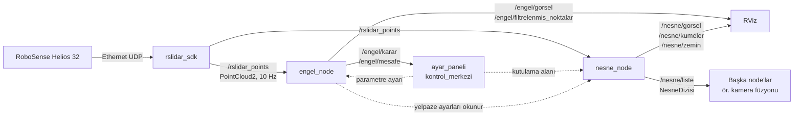

<div align="center">

# 🚧 lidar_algilama — LiDAR ile Engel ve Nesne Algılama

**RoboSense Helios 32** nokta bulutundan gerçek zamanlı **DUR / DİKKAT / GÜVENLİ** kararı,
3B nesne kutuları, mesafe, kaba etiket (yaya adayı / yapı / engel) ve nesne takibi.


<sub>Gerçek LiDAR kaydı, RViz. <b>Turuncu</b>: engel kutuları · <b>mavi</b>: yaya adayı ·
<b>sarı yelpaze</b>: uyarı alanı (kırmızı yay = DUR sınırı) · <b>açık mavi</b>: kutulama alanı.
Her kutunun üstünde takip numarası, etiket ve mesafe yazar.</sub>

</div>

Robotaksi çalışma alanının `algilama/` katmanındaki paket ([çalışma alanı rehberi](../../../README.md)).
Araca komut vermez; sonuçlarını topic olarak yayınlar, sürüş yöntemleri istediğini okur.
Arayüz, ayar paneli ve kayıt/oynatma [`kontrol_merkezi`](../../araclar/kontrol_merkezi/README.md) paketindedir.

---

## ✨ Ne yapar?

**`engel_node` — sektör tabanlı engel kararı**
- LiDAR'ın etrafında istediğiniz yöne, istediğiniz genişlikte bir **yelpaze** (sektör) çizer.
- Yelpazenin içindeki, yükseklik ve mesafe filtresinden geçen noktalara bakar.
- En yakın engele göre **DUR** (kırmızı), **DİKKAT** (sarı) veya **GÜVENLİ** (yeşil) kararı yayınlar.
- Tek tük gürültü noktaları (toz, yağmur, yansıma) karar vermesin diye **en az N nokta** şartı ve
  mesafeyi en yakın N'inci noktaya göre ölçer.
- Engel tam sınırdayken kararın titrememesi için **histerezis** (10 cm) uygular.

**`nesne_node` — nesne algılama katmanı**
- Zemini her turda **RANSAC** ile ölçüp ayırır (sabit bir zemin yüksekliğine güvenmez).
- Kalan noktaları **kümeleyip** nesnelere ayırır (uzaktaki nesneler için mesafeye göre büyüyen tolerans).
- Her nesneyi **yönlü 3B kutu** içine alır, LiDAR'a en yakın noktasının **yatay mesafesini** ölçer.
- Kutunun şekline göre kaba etiket verir: **yaya adayı**, **yapı** (duvar vb.), **engel**.
- Nesneleri kareden kareye **takip eder**: numara, hız, yaklaşma hızı ve çarpışma süresi.
- Sonuçları `/nesne/liste` topic'inde yayınlar — başka node'lar (ör. kamera füzyonu) doğrudan okuyabilir.

> **Not:** Hiçbir node LiDAR'ın kendisine veya sürücüsüne ayar göndermez. Sadece sürücünün
> yayınladığı `/rslidar_points` bulutunu okur ve kendi içinde filtreler.

---

## 📸 Ekran görüntüleri

Aynı ayarlarla, engel yaklaştıkça kararın değişimi (DUR sınırı 1.9 m, DİKKAT sınırı 3.0 m):

<table>
  <tr>
    <th width="33%">🟢 GÜVENLİ</th>
    <th width="33%">🟡 DİKKAT</th>
    <th width="33%">🔴 DUR</th>
  </tr>
  <tr>
    <td></td>
    <td></td>
    <td></td>
  </tr>
  <tr>
    <td align="center"><sub>Görüş alanında engel yok</sub></td>
    <td align="center"><sub>Engel önde, 2.70 m'de</sub></td>
    <td align="center"><sub>Engel solda 24°, 1.00 m'de</sub></td>
  </tr>
</table>

Yukarıdan bakış çiziminde **kırmızı** bölge DUR, **sarı** bölge DİKKAT alanıdır, **mavi kesik çizgi**
nesne kutulama alanını gösterir. Kararı veren nokta çizimde işaretlenir; üstte hangi açıda, kaç metrede
ve hangi yükseklikte olduğu yazar.

---

## 🧠 Nasıl çalışır?



### `engel_node` her turda (10 Hz)

1. **Yelpaze testi** — noktanın yatay yönü, bakış yönünden `gorus_genisligi / 2`'den fazla sapıyorsa atılır.
2. **Mesafe filtresi** — `min_mesafe`'den yakın (aracın kendisi, masa) ve `dikkat_mesafesi`'nden uzak noktalar atılır.
3. **Yükseklik filtresi** — `z_min` altındaki (zemin) ve `z_max` üstündeki (tavan, ağaç dalı) noktalar atılır.
4. **Gürültü filtresi** — kalan nokta sayısı `min_nokta_sayisi`'ndan azsa engel yok sayılır. Engel mesafesi
   olarak en yakın noktanın değil, **en yakın N'inci noktanın** mesafesi kullanılır (tek bir yansıma DUR verdiremez).
5. **Karar** — mesafe `dur_mesafesi`'nden küçükse DUR, `dikkat_mesafesi`'nden küçükse DİKKAT, değilse GÜVENLİ.
   Bir karardan **çıkmak** için engelin sınırdan 10 cm daha uzaklaşması gerekir (histerezis).

### `nesne_node` her turda

```
nokta bulutu → kutulama alanı + gövde kutusu + voxel seyreltme
             → zemin ayırma (RANSAC, zemin_z ± zemin_bant içinde)
             → kümeleme (yatay + mesafeye göre büyüyen dikey tolerans)
             → yönlü kutu + en yakın nokta mesafesi + tepe yüksekliği
             → kaba etiket (yaya_adayi / yapi / engel)
             → takip (numara, hız, yaklaşma hızı, çarpışma süresi)
             → /nesne/liste + RViz görselleri
```

Algoritmalar ROS'tan bağımsız olarak [`src/nesne/`](src/nesne/) altındadır
(`zemin`, `kumeleme`, `kutu`, `takip`); ROS tarafı sadece `nesne_node.cpp`'dedir.

> ⚠️ Etiketler **kural tabanlıdır ve kabadır**. "Yaya adayı" kesin bir yaya kararı değildir;
> kutunun boyutuna ve tepe yüksekliğine bakılarak verilen bir tahmindir.

---

## 🚀 Çalıştırma

İki düğümü birlikte (LiDAR sürücüsü başka yerde açıksa ya da kayıt oynatılıyorsa):

```bash
ros2 launch lidar_algilama lidar_algilama.launch.py
```

| Argüman | Varsayılan | Açıklama |
|---|---|---|
| `nesne` | `true` | `nesne_node`'u (kutu / mesafe / takip) aç |

Parametreler önce `config/*.yaml`'dan, sonra varsa ayar panelinin kaydettiği
`~/.ros/kontrol_merkezi/son_ayarlar.yaml`'dan yüklenir.

Sürücü + RViz + düğümler + ayar paneli hepsi birden:
[`ros2 launch kontrol_merkezi lidar_sistem.launch.py`](../../araclar/kontrol_merkezi/README.md#-çalıştırma)

Düğümleri tek tek çalıştırmak:

```bash
ros2 run lidar_algilama engel_node --ros-args --params-file src/algilama/lidar_algilama/config/engel_params.yaml
```

```bash
ros2 run lidar_algilama nesne_node --ros-args --params-file src/algilama/lidar_algilama/config/nesne_params.yaml
```

---

## ⚙️ Parametreler

Tüm parametreler **çalışırken** değiştirilebilir (panelden veya `ros2 param set` ile).
Ondalıklı değerleri YAML'da mutlaka `90.0` gibi noktalı yazın, yoksa ROS tip hatası verir.

Eksenler LiDAR'a göredir: **x = ileri, y = sol, z = yukarı**, birim metre.
Açılar derece: **0 = ön, +90 = sol, −90 = sağ, 180 = arka**.

### `engel_node` — [`config/engel_params.yaml`](config/engel_params.yaml)

| Parametre | Varsayılan | Açıklama |
|---|---|---|
| `merkez_aci` | `0.0` | Yelpazenin baktığı yön (°) |
| `gorus_genisligi` | `90.0` | Yelpazenin toplam açısı (°). `360` = her yön |
| `min_mesafe` | `0.3` | Bundan yakın noktalar yok sayılır (aracın kendisi, masa) |
| `z_min` | `-1.2` | LiDAR merkezinden bu kadar aşağısı yok sayılır — **zeminin biraz üstünde olmalı** |
| `z_max` | `1.0` | LiDAR merkezinden bu kadar yukarısı yok sayılır (tavan, dal, köprü) |
| `dur_mesafesi` | `2.0` | Engel bundan yakınsa **DUR** |
| `dikkat_mesafesi` | `5.0` | Engel bundan yakınsa **DİKKAT**. Daha uzağı işlenmez |
| `min_nokta_sayisi` | `10` | Engel sayılması için en az nokta; mesafe en yakın N'inci noktaya göre ölçülür |
| `canli_izleme` | `true` | Her turda karar + mesafe terminale yazılır |

### `nesne_node` — [`config/nesne_params.yaml`](config/nesne_params.yaml)

Varsayılanlar **masa** düzenine göredir (LiDAR masada, zemin ~0.81 m aşağıda).

<details>
<summary><b>Tüm parametreleri göster</b></summary>

| Grup | Parametre | Varsayılan | Açıklama |
|---|---|---|---|
| Alan | `nesne_merkez_aci` | `0.0` | Kutulama alanının yönü (°) — uyarı yelpazesinden **bağımsız** |
| | `nesne_gorus_genisligi` | `120.0` | Kutulama alanının açısı (°) |
| | `menzil` | `20.0` | Bundan uzak noktalar işlenmez (yatay, m) |
| | `govde_x_min` … `govde_y_max` | masa ölçüleri | Gövde kutusu: içindeki noktalar yok sayılır. Hepsi `0.0` = kapalı |
| | `voxel_boyu` | `0.08` | Nokta seyreltme küp boyu (m). `0.0` = kapalı |
| Zemin | `zemin_z` | `-0.81` | Beklenen zemin yüksekliği. Araçta: `-montaj_yüksekliği` |
| | `zemin_bant` | `0.30` | Zemin sadece `zemin_z ± bant` içinde aranır |
| | `zemin_esik` | `0.10` | Zemin düzlemine bundan yakın nokta zemin sayılır |
| | `zemin_max_egim` | `10.0` | Zemin en fazla bu kadar eğik olabilir (°) |
| | `zemin_min_nokta` | `30` | Zemin düzleminin kabulü için en az nokta |
| | `max_yukseklik` | `2.5` | Zeminden bu kadar yukarısı yok sayılır |
| Kümeleme | `kume_yatay_tol` | `0.35` | Aynı nesne için en fazla yatay aralık (m) |
| | `kume_dikey_taban` / `kume_dikey_artis` | `0.25` / `0.04` | Dikey eşik = taban + artış × mesafe |
| | `kume_min_nokta` / `kume_max_nokta` | `5` / `20000` | Küme boyut sınırları |
| Etiket | `yaya_min_tepe` / `yaya_max_tepe` | `1.0` / `2.1` | Yaya adayı: tepe noktası zeminden bu aralıkta |
| | `yaya_max_uzunluk` / `yaya_max_genislik` | `1.2` / `1.0` | …ve taban en fazla bu boyutta |
| | `yapi_min_uzunluk` / `yapi_max_genislik` | `2.5` / `0.5` | Yapı: uzun ve ince |
| | `yapi_kesin_uzunluk` | `6.0` | …ya da bundan uzun her şey |
| Takip | `takip_kapi` | `1.0` | Bir turda en fazla bu kadar yer değiştirebilir (m) |
| | `takip_dogrulama` | `3` | Yeni nesne bu kadar tur üst üste görülünce numara alır |
| | `takip_kayip` | `5` | Bu kadar tur görülmeyen nesne silinir |
| | `canli_izleme` | `true` | Saniyede bir özet satırı |

</details>

Çalışırken değiştirme örneği:

```bash
ros2 param set /engel_node dur_mesafesi 1.5
```

```bash
ros2 param set /nesne_node zemin_z -1.80
```

---

## 📡 Topic'ler ve mesajlar

### Giriş

| Topic | Tip | Açıklama |
|---|---|---|
| `/rslidar_points` | `sensor_msgs/PointCloud2` | LiDAR nokta bulutu (frame `rslidar`, ~10 Hz, SensorData QoS) |

### `engel_node` çıkışları

| Topic | Tip | Açıklama |
|---|---|---|
| `/engel/karar` | `std_msgs/String` | `DUR`, `DIKKAT` veya `GUVENLI` |
| `/engel/mesafe` | `std_msgs/Float32` | Engelin mesafesi (m) |
| `/engel/engel_noktasi` | `geometry_msgs/PointStamped` | Kararı veren noktanın konumu |
| `/engel/filtrelenmis_noktalar` | `sensor_msgs/PointCloud2` | Tüm filtrelerden geçen noktalar |
| `/engel/gorsel` | `visualization_msgs/MarkerArray` | Yelpaze, DUR/DİKKAT yayları, karar yazısı |

### `nesne_node` çıkışları

| Topic | Tip | Açıklama |
|---|---|---|
| `/nesne/liste` | `robotaksi_msgs/NesneDizisi` | Takip edilen tüm nesneler |
| `/nesne/gorsel` | `visualization_msgs/MarkerArray` | Kutular, numara/etiket/mesafe yazıları, hız okları |
| `/nesne/kumeler` | `sensor_msgs/PointCloud2` | Her nesne ayrı renkte noktalar |
| `/nesne/zemin` | `sensor_msgs/PointCloud2` | Zemin olarak ayrılan noktalar |
| `/nesne/zemin_disi` | `sensor_msgs/PointCloud2` | Zemin dışında kalan noktalar |

### `robotaksi_msgs/Nesne`

```
uint32 id                          # takip numarası
string etiket                      # "yaya_adayi" | "yapi" | "engel"
float32 guven                      # 0..1, kural tabanlı güven puanı

geometry_msgs/Point merkez         # kutunun merkezi
geometry_msgs/Vector3 boyut        # x = uzunluk, y = genişlik, z = yükseklik
float32 yon                        # kutunun z ekseni etrafındaki açısı (radyan)

geometry_msgs/Point en_yakin_nokta # LiDAR'a en yakın nokta
float32 mesafe                     # en yakın noktanın yatay mesafesi (m)
float32 tepe_yuksekligi            # en üst noktanın zemin üstü yüksekliği (m)

geometry_msgs/Vector3 hiz          # m/s
float32 yaklasma_hizi              # m/s, pozitif = LiDAR'a yaklaşıyor
float32 carpisma_suresi            # saniye; yaklaşmıyorsa -1

bool uyari_alaninda                # engel_node'un uyarı yelpazesinin içinde mi
uint32 nokta_sayisi
uint32 yas                         # kaç turdur takipte
```

Hızlıca izlemek için:

```bash
ros2 topic echo /engel/karar
```

```bash
ros2 topic echo /nesne/liste --field nesneler
```

---

## 🚗 Masadan araca geçerken

Varsayılan değerler LiDAR masadayken ölçüldü. Araca takarken en az şunları güncelleyin:

| Ayar | Masada | Araçta (örnek: LiDAR yerden 1.8 m) |
|---|---|---|
| `engel_node.z_min` | `-0.1` … `-0.6` | `-1.6` civarı (zeminin ~20 cm üstü) |
| `engel_node.min_mesafe` | `~1.0` | Aracın gövdesi kadar |
| `nesne_node.zemin_z` | `-0.81` | `-1.80` |
| `nesne_node.govde_*` | masa ölçüleri | Aracın LiDAR'a göre kutusu |

> 💡 `z_min` çok aşağıda kalırsa **zemin engel sanılır** ve sürekli DUR alırsınız. Panelde *Alt sınır (zemin)*
> çubuğunu, RViz'de zemin noktaları kaybolana kadar yukarı alın.

Panelde **Kaydet…** ile `masa` ve `arac` diye iki profil oluşturup ortam değiştikçe tek tıkla geçebilirsiniz.

---

## 🩺 Sorun giderme

| Belirti | Olası neden / çözüm |
|---|---|
| RViz'de nokta yok | Ethernet IP'si yanlış veya `lidar_type` hatalı. `ros2 topic hz /rslidar_points` ile kontrol edin |
| Node'lar veri almıyor / takılıyor | Fast DDS büyük mesaj ayarı eksik. `FASTRTPS_DEFAULT_PROFILES_FILE` değişkenini verin (kök [README → Kurulum](../../../README.md#-kurulum)) |
| Sürekli DUR | `z_min` zemine çok yakın, ya da `min_mesafe` aracın/masanın kendisini içine alıyor |
| Küçük cisimler kaçıyor | `min_nokta_sayisi`'nı azaltın |
| Toz/yağmurda yanlış DUR | `min_nokta_sayisi`'nı artırın (20–30) |
| Ondalıklı parametrede "tip uyuşmuyor" | YAML'da `90` yerine `90.0` yazın |
| Başka bilgisayarın ROS verisi karışıyor | `ROS_DOMAIN_ID` ve `ROS_AUTOMATIC_DISCOVERY_RANGE=LOCALHOST` |
| PCL derlenirken `CMP0144 / FLANN_ROOT` uyarısı | PCL'in kendi CMake dosyasından gelir, zararsızdır |

---

## 🗂️ Paket yapısı

```
lidar_algilama/
├── config/
│   ├── engel_params.yaml        # engel_node varsayılanları
│   └── nesne_params.yaml        # nesne_node varsayılanları
├── launch/
│   └── lidar_algilama.launch.py # iki düğüm
└── src/
    ├── engel_node.cpp           # sektör tabanlı DUR / DİKKAT / GÜVENLİ
    ├── nesne_node.cpp           # nesne algılamanın ROS tarafı
    └── nesne/                   # ROS'tan bağımsız algoritmalar
        ├── zemin.*              #   RANSAC zemin ayırma
        ├── kumeleme.*           #   nokta kümeleme
        ├── kutu.*               #   yönlü kutu + etiket
        └── takip.*              #   nesne takibi
```

Mesajlar (`Nesne`, `NesneDizisi`) ortak [`robotaksi_msgs`](../../ortak/robotaksi_msgs/) paketindedir.
